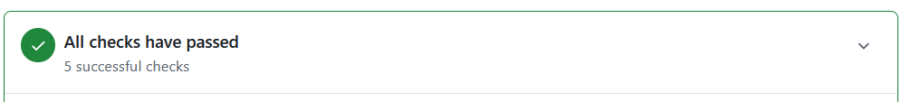
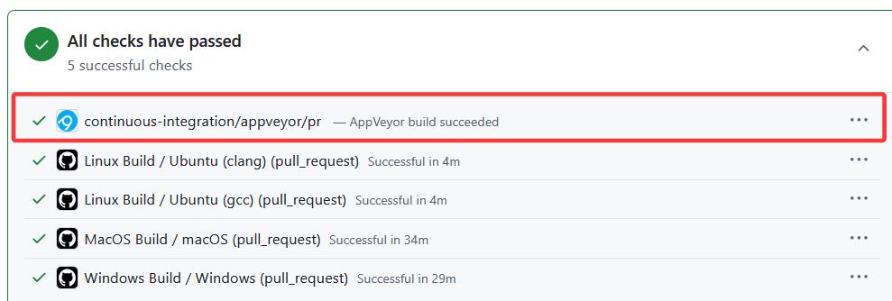
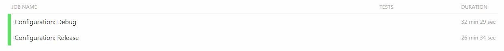
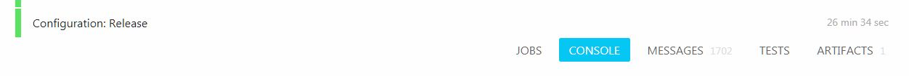
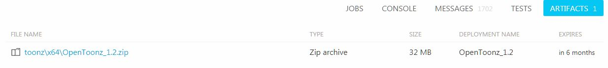
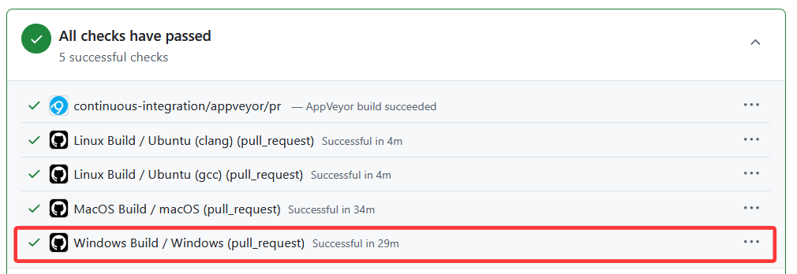
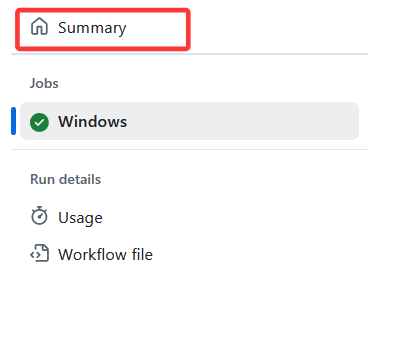
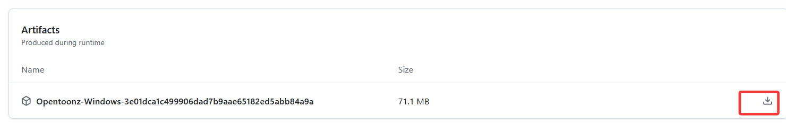

# Testing Pull Requests (PRs)

PR artifacts depend on the repository and workflow. Use the current PR checks to find a successful build for the commit under test. GitHub Actions and legacy AppVeyor download instructions are included below. Check whether the artifact contains only executables/DLLs or also a matching `stuff` or `portablestuff` directory before testing.

## Pre-Testing Notes
- Executable-only artifacts need a compatible existing installation/configuration. Self-contained portable artifacts may include their own `portablestuff`; inspect the artifact instructions. Do not uninstall your existing application.
- It is recommended that you backup your `C:\OpenToonz stuff` folder before testing a PR.
- Legacy executable-only AppVeyor artifacts may omit updated `stuff`. Do not assume configuration, stylesheets, FXs, brushes, or translation catalogs match the executable.
- It is recommended when testing to use new scenes that you can throw away.
  - If you decide to test on an existing scene, back it up first!

## Downloading and Testing AppVeyor Builds

- Go to the PR you are interested in checking out.

- Scroll to the bottom of the page and look for the green-outlined box with `All checks have passed` in it. Click on it to expend.

- Look for where it says `AppVeyor build succeeded` and click on the `...` next to it, select `View Details`.

- Click on `Configuration: Release`.

- On the right side of the page, click on `Artifacts`.

- Click on the OpenToonz `.zip` file to begin the download.

## Downloading and Testing Github Action Builds

- Similar to the previous steps, but start clicking different lines from step 3.

- On the **Details** page, click **Summary** on the left side.

- Scroll down to find the **Download** button.

  

---

- Once download is complete, go to your Downloads folder and extract the contents of the .zip file anywhere on your computer.
 - You should extract into a separate folder. 
 - ⚠️ **Do not overwrite your current OpenToonz installation!**
- Enter the folder you extracted everything into and double-click the OpenToonz executable to start.
- Test away!  Report any suggestions or issues related to the change in the PR comments.
- You can safely delete the .zip file and the folder you created when you are done.

## Testing translation changes

Follow the [translation guide](../toonz/sources/translations/README.md) to check
which configuration directory the test executable loads. Verify the changed
`loc/<UI language name>/<module>.qm` is present and current; an executable-only
update does not establish this. Select the language, restart, and inspect the
changed UI. Report the language, commit/build, catalog path, and observed wording.
